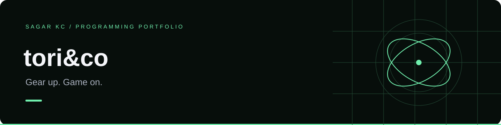

# tori&co · Gaming Store

A yellow-and-black gaming storefront with real branded product photos and a complete demo shopping flow.

**HTML · CSS · JavaScript · SVG · Node.js tests**

### [Open the public live demo ↗](https://sagarkhatriii.github.io/gaming-store/)

## Features

- Six branded products: NVIDIA GPU, AMD CPU, and Razer headset, keyboard, mouse, and monitor
- Real product images with [source credits](./IMAGE-SOURCES.md)
- Product details, category filters, search, and price/name sorting
- Cart quantity controls, removal, item counts, and CAD subtotal
- Validated cart persistence in browser storage
- Demo checkout, confirmation, and cart reset
- Responsive layout and keyboard-accessible modal dialogs

## Run locally

```sh
python -m http.server 8000 --directory dist
```

Visit http://localhost:8000. On Windows, replace `python` with `py` if necessary.

## Test

Run `node test.cjs`. Tests cover catalogue filters, sorting, saved-cart validation, quantity limits, totals, and product photo references.

## Structure

| Path | Responsibility |
| --- | --- |
| `dist/index.html` | Storefront and dialogs |
| `dist/app.js` | Catalogue, filtering, cart, and checkout |
| `dist/style.css` | Responsive yellow-and-charcoal design |
| `dist/assets/` | Original hardware illustrations |
| `test.cjs` | Functional checks |

## Demo boundaries

Product names represent real branded hardware. Prices are sample CAD prices for this demo. No real payments, deliveries, inventory checks, or taxes are processed. No customer details are collected. The project is not affiliated with Razer or Amazon.

## Future work

A production version would need a backend, a trusted product database, inventory validation, and a payment-provider integration.

Product photos load from external sources and require an internet connection. Manufacturer and retailer image rights remain with their owners.
